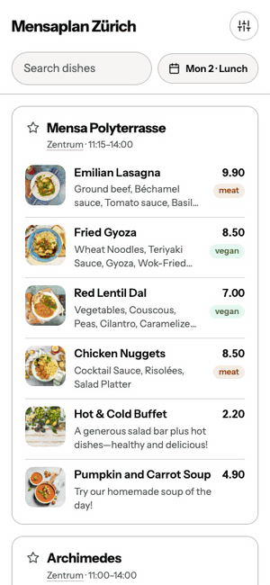

# Mensa Finder

Mensa Finder shows the menus of the ETH, UZH and other canteens in Zurich (and ETH Basel) on
one page, with prices, photos and allergens. It started as *UniEats* at VISCon Hackathon 2026
(team VISard Lizards). It was then rewritten from scratch as one small Go program with no
database and no accounts. The code was written with AI under my direction.



[](LICENSE)


## Features

- **Every menu on one page.** 34 canteens from ETH Zurich and the ZFV (UZH and others), with
  real prices for students, staff and external guests.
- **Dish details.** Tap a dish to see its photo large, its ingredients, allergens and all
  prices. Only one dish is open at a time, centred on the screen.
- **Your campuses, your diet.** Settings show only the campuses you pick, only vegetarian or
  vegan dishes, and hide dishes with the allergens you choose. Changes apply immediately.
- **Favourites and starred dishes.** A starred canteen stays at the top of the page. A starred
  dish is listed first and marked wherever it is on the menu, on any day.
- **Any day, lunch or dinner.** The calendar button next to the search shows menus up to two
  weeks ahead. After 15:00 it switches to dinner on its own.
- **No account.** Settings live in a cookie in your browser. The server stores no personal data.
- **German and English, light and dark.** The language follows the browser until you pick one.

## Quick start

You need Go 1.27 or newer.

```bash
go run .
```

Open http://localhost:8080. The first start fetches all menus, which takes about a minute.
UZH prices take a few minutes the very first time and are cached after that. Menus are saved in
`./data`, so later starts show the last known menus right away.

The program reads three optional environment variables: `ADDR` (default `:8080`), `DATA_DIR`
(default `./data`) and `REFRESH_EVERY` (default `1h`).

Run the tests with:

```bash
go test ./...
```

## How it works

```
                                                  every hour
Browser ─► proxy ─► Caddy (HTTPS) ─► Mensa Finder ◄──────────── ETH menu API
                                     (Go, one binary)  ◄─────── app.food2050.ch (UZH and other ZFV canteens)
                                           │
                                           └─ data/menus.json, data/photos/
```

1. **Fetching.** On start and every hour, the program asks both sources for the current week and
   the two following ones. ETH has a JSON API. FOOD2050 has no API, so the program reads the data
   its pages embed for the browser. If a source is down, the menus it delivered earlier stay.
2. **Storing.** Menus live in memory and are saved to `data/menus.json` after every refresh. A
   few weeks of menus for ~35 canteens is well under a megabyte, so there is no database.
3. **Showing.** Every page request renders the HTML from the stored menus. A small script,
   `app.js`, filters instantly by hiding what doesn't match. It also animates opening dishes and
   writes the settings cookie.
4. **Photos.** The first request for a photo downloads the original once. It saves a 168 px
   thumbnail and a 1080 px wide version in `data/photos/`. Photos of dishes that are no longer
   on any menu are deleted after each refresh.

| Directory | What |
|-----------|------|
| `main.go` | Starts everything: the refresher in the background and the web server. |
| `internal/catalog/` | The list of canteens (`canteens.json`): name, campus, address and where each menu comes from. **Add or fix a canteen here.** |
| `internal/menu/` | The data model (day, meal, dish), the store that saves `data/menus.json`, and clean-up of allergen names and ALL-CAPS names. |
| `internal/eth/` | Reads ETH's weekly menu plans in English and German. |
| `internal/food2050/` | Reads FOOD2050 weekly pages and dish pages (prices, photo) by decoding the Next.js data in them. |
| `internal/refresh/` | Runs both sources on a timer and writes into the store. |
| `internal/photos/` | Downloads, resizes and caches dish photos. It serves only photos of dishes on the menus. |
| `internal/web/` | The web server: routes, the settings cookie, all texts in English and German, the page template, and `static/` (CSS, JavaScript, fonts). |

Routes: `/` is the page (`?day=YYYY-MM-DD&meal=lunch|dinner`).
`/photos/<key>.jpg` and `/photos/<key>-large.jpg` serve photos. `/api/menu?day=YYYY-MM-DD`
returns that day's menus as JSON. `/healthz` answers while the server runs (Docker's health
check uses it). `/healthz/menus` answers 503 when a source hasn't refreshed for 6 hours, which
makes it the address to watch with an uptime monitor.

## Deploying

Everything runs in Docker on one server, behind the shared
[webserver-proxy](https://github.com/gmiszori/webserver-proxy). The proxy owns ports 80 and 443
and passes this domain's traffic to Caddy without decrypting it. Caddy gets and renews the HTTPS
certificate by itself and passes requests on to Mensa Finder. Neither is reachable from outside
except through the proxy.

1. Point the domain's DNS A (and AAAA) record at the server.
2. Open inbound TCP 80 and 443, and make sure the proxy is running with `MENSA_DOMAIN` set to
   your domain.
3. On the server:
   ```bash
   git clone https://github.com/gmiszori/mensa.miszori.dev && cd mensa.miszori.dev
   cp .env.example .env   # set DOMAIN
   docker compose up --build -d
   ```

To update, pull the new code and run `docker compose up --build -d` again. Menus and photos live
in the `data` volume and certificates in `caddy_data`, so restarts and updates lose nothing.
Caddy's version is pinned in `docker-compose.yml`; to update it, change the tag there.

Logs: `docker compose logs -f`. Caddy writes one line per request. Docker keeps at most
30 MB of logs per container.
To try the production setup locally, start the proxy first with `PUBLIC_BIND_IP=127.0.0.1` and
`MENSA_DOMAIN=localhost` in its `.env`. Without a `.env` here, Caddy then serves https://localhost
with a local certificate.

### Configuration (`.env`)

| Variable | Default | |
|----------|---------|--|
| `DOMAIN` | `localhost` | The domain Caddy serves and gets the certificate for. Must match `MENSA_DOMAIN` in the proxy. |
| `REFRESH_EVERY` | `1h` | How often menus are fetched again. |

## Security

- **Strict content security policy.** The page loads scripts, styles, fonts and images only from
  its own origin. This blocks injected scripts and third-party tracking.
- **Escaped output.** Menu texts come from other websites and are always HTML-escaped by Go's
  templates, so a dish name can't inject markup.
- **No open photo proxy.** `/photos/` serves only photos of dishes on the menus, looked up by a
  hash. Anyone else's URLs, and paths that try to leave the cache folder, get a 404.
- **Size limits on photos.** A source's image may be at most 15 MB and 12 megapixels. Its size is
  checked before decoding, so one oversized image can't exhaust the memory. At most four photos
  are downloaded at a time, and each only once.
- **No accounts, no personal data.** Settings stay in the visitor's cookie. Nothing on the server
  can be changed from outside: refreshes run only on the timer.
- **Minimal, non-root container.** The image holds only the program (distroless, about 20 MB),
  runs as an unprivileged user with a memory limit, and sits behind Caddy.
- **HTTPS only.** Caddy redirects HTTP to HTTPS and sends HSTS, so browsers keep using HTTPS.
- **Real addresses only from the proxy.** Caddy trusts the visitor address in a PROXY header only
  from the proxy's fixed address (`172.31.250.2`), so another container can't fake one in the
  logs.
- **Timeouts.** The server limits how long reading and writing a request may take. This stops
  slow clients from holding connections open.

Keep the server and the images up to date. Caddy's access log contains visitors' IP addresses;
Docker keeps only the last 30 MB of it, so state that in a privacy notice if you need one. ETH's
API is called with the client id that ethz.ch itself uses. FOOD2050 is read from its website, so
if the site changes, UZH menus stop updating while the tests still pass. Watch the logs for
`FOOD2050 refresh failed`.

## License

[MIT](LICENSE)
